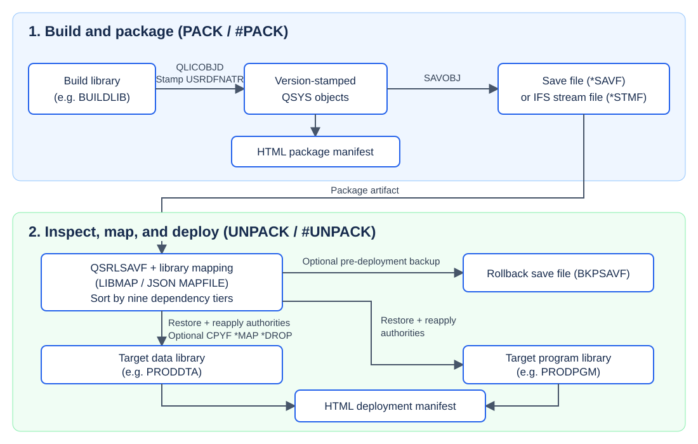
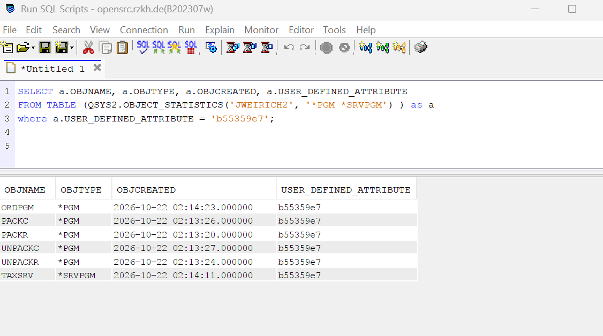
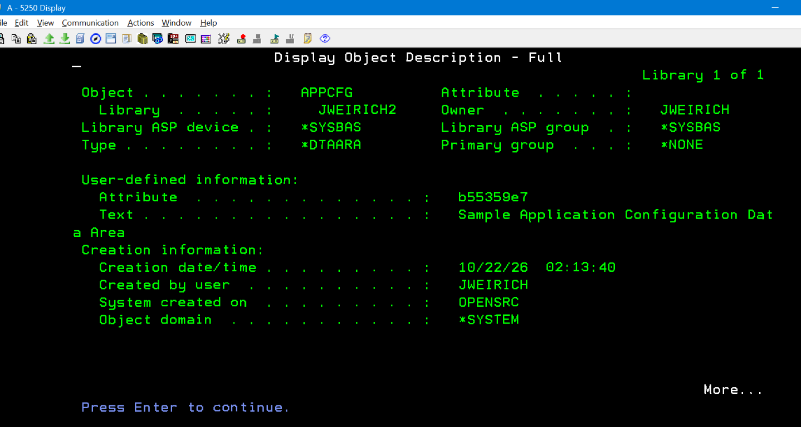
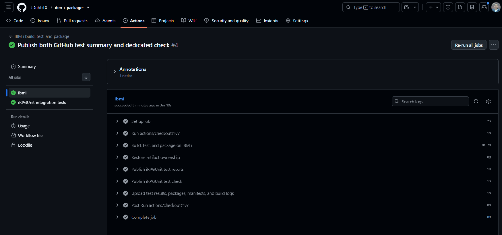
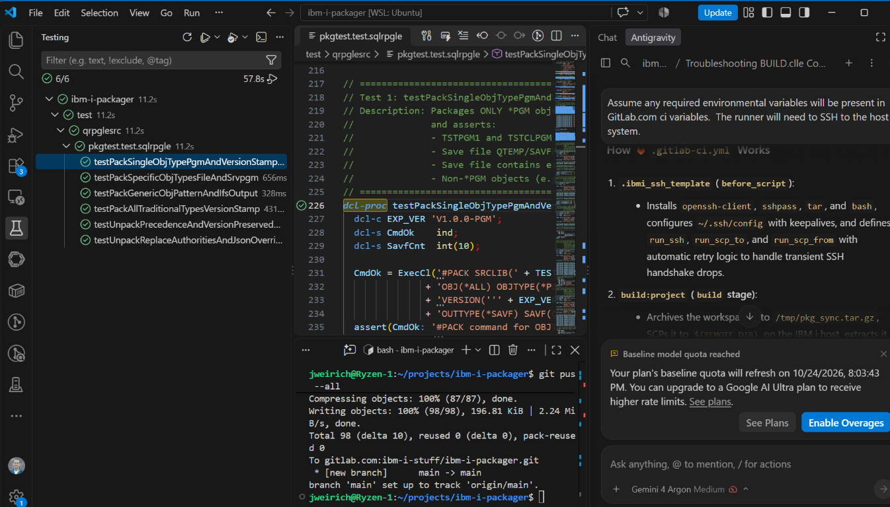
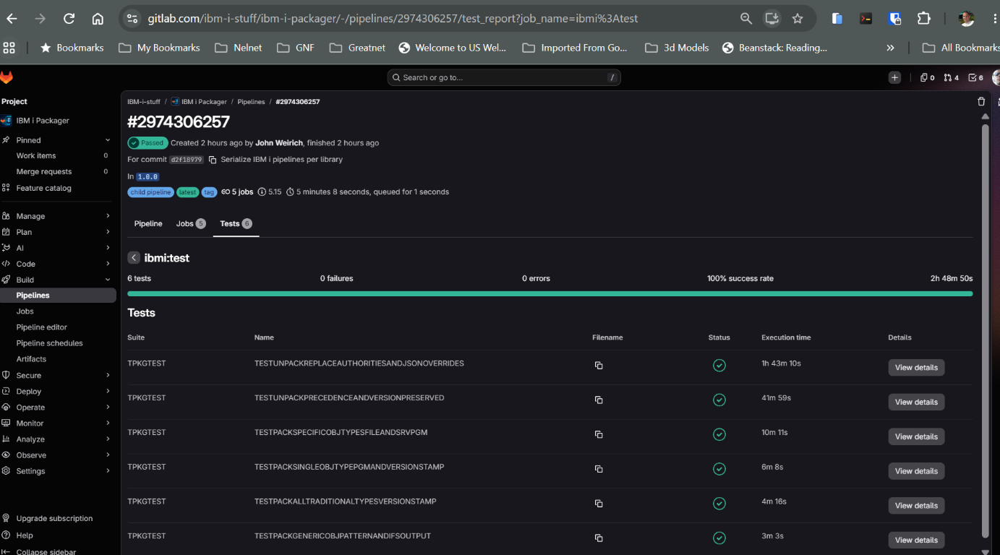
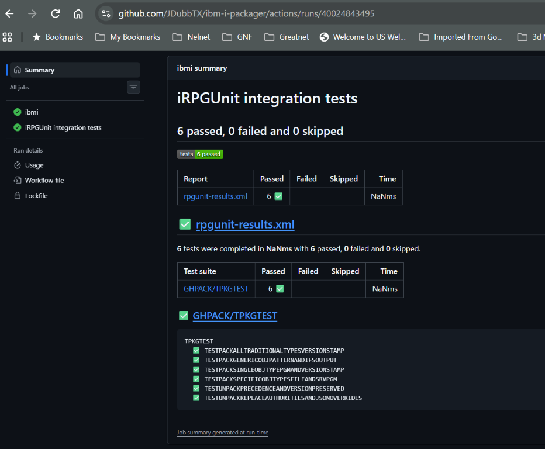

# IBM i Packager (`PACK` / `#PACK` & `UNPACK` / `#UNPACK`)

**Native, dependency-aware release packaging, version stamping, and data-preserving deployment for IBM i CI/CD pipelines.**

[](https://opensource.org/licenses/Apache-2.0)
[](https://www.ibm.com/it-infrastructure/power/os/ibm-i)
[-0f62fe.svg)](https://github.com/IBM/ibmi-tobi)
[](https://irpgunit.sourceforge.io/)
[](https://gitlab.com/ibm-i-stuff/ibm-i-packager)
[](https://github.com/JDubbTX/ibm-i-packager)

---

## Overview

Modern IBM i development teams use Git, VS Code ([Code for IBM i](https://github.com/codefori/vscode-ibmi)), and [IBM i TOBi (`makei`)](https://github.com/IBM/ibmi-tobi) to build applications in isolated build libraries. However, turning a build library into a versioned release artifact—and safely deploying that artifact into target environments where data and object authorities already exist—remains a common gap in IBM i DevOps pipelines.

**IBM i Packager** solves this with two native CL commands backed by `SQLRPGLE` engines (`PACKR` and `UNPACKR`):

1. **`PACK` (`#PACK`)** — Discovers objects in a build library (by name, generic wildcard, or object type), stamps a **10-character release version** directly onto each object's User-Defined Attribute (`USRDFNATR`) via the `QLICOBJD` API, packages them into a QSYS Save File (`*SAVF`) or portable IFS stream file (`*STMF`), and generates a styled HTML Package Manifest.
2. **`UNPACK` (`#UNPACK`)** — Inspects a package Save File or IFS stream file via the `QSRLSAVF` (`SAVF0200`) API, routes objects to one or more target libraries (e.g., `PRODDTA` vs. `PRODPGM`) using inline rules or a JSON mapping file (`MAPFILE`), optionally creates a pre-deployment rollback backup (`BKPSAVF`), and restores objects in **nine dependency precedence tiers** while reapplying existing object authorities and optionally migrating existing Physical File / SQL Table data.

---

## Key Features

- **Native Object Version Stamping (`USRDFNATR`)**
  Stamps every packaged object—and the package Save File itself—with a 10-character version identifier in its QSYS User-Defined Attribute (`QLICOBJD` key `9`). Query deployed versions anytime via `DSPOBJD` or `QSYS2.OBJECT_STATISTICS`.
- **All Traditional QSYS & SQL Object Types**
  Supports `*PGM`, `*SRVPGM`, `*MODULE`, `*BNDDIR`, `*FILE` (`PF`, `LF`, `DSPF`, `PRTF`, SQL `TABLE`, `VIEW`, `INDEX`, `MQT`), `*SQLPKG`, `*DTAARA`, `*DTAQ`, `*MSGF`, `*CMD`, `*PNLGRP`, `*MENU`, `*JOBD`, `*CLS`, `*SBSD`, `*AUTL`, and more.
- **Nine-Tier Dependency Precedence Unpacking**
  Automatically orders objects before restoring so physical tables exist before logical views, binding directories and modules exist before service programs, and programs exist before commands.
- **Data-Preserving Database Upgrades (`CPYDTA` & `preserveData`)**
  When replacing an existing Physical File or SQL Table:
  - Automatically identifies dependent Logical Files / Views (`DSPDBR`), temporarily suspends un-packaged LFs to a staging save file, and restores them after the PF is upgraded.
  - Migrates existing production data into the newly unpacked table layout via `CPYF FROMMBR(*ALL) TOMBR(*FROMMBR) MBROPT(*REPLACE) FMTOPT(*MAP *DROP)`.
  - Supports per-file JSON overrides (`"preserveData": false`) so reference/seed tables (e.g., `SYSCFG`, `ERRCODES`) are refreshed from the package while transactional tables (`CUSTPF`, `ORDHDR`) keep their existing data.
- **Complete Object Authority Preservation**
  Before replacing any existing object, captures its **Owner**, **Primary Group (`PGP`)**, **Authorization List (`AUTL`)**, **`*PUBLIC` authority**, and **all private user authorities** (`QSYS2.OBJECT_PRIVILEGES`), re-applying them onto the newly unpacked object.
- **Multi-Library Routing (`LIBMAP` & JSON `MAPFILE`)**
  Build everything in a single CI build library and route `*FILE PF`/`LF` and `*DTAARA` to `PRODDTA` while routing `*PGM`, `*SRVPGM`, and `DSPF`/`PRTF` to `PRODPGM`.
- **Automatic Rollback Backups & HTML Audit Manifests**
  Optionally saves all existing target objects being replaced into `BKPSAVF` prior to deployment and generates self-contained HTML manifests for CI/CD pipeline artifacts.

Data migration uses field mapping and drops unmatched fields; it is not a guarantee of lossless schema conversion. Validate changes in a non-production library and retain an independent backup before deployment. `BKPSAVF` creates a backup, not an automatic rollback.

---

## Architecture & Workflow



`PACK` stamps build objects via `QLICOBJD`, saves them with `SAVOBJ`, and writes a package manifest. `UNPACK` inspects the package via `QSRLSAVF`, applies library mapping, optionally backs up existing objects, and restores in nine dependency tiers. It reapplies authorities, optionally migrates existing table data using `CPYF *MAP *DROP`, and writes a deployment manifest.

---

## System Requirements, Minimum OS Level & PTFs

### 1. Minimum IBM i OS & Technology Refresh (TR) / PTF Levels

| IBM i Release | Minimum TR Level | Required Db2 PTF Group | Additional Compiler PTFs | Notes |
| :--- | :--- | :--- | :--- | :--- |
| **IBM i 7.5 (`V7R5M0`)** | Base | `SF99950` (Base+) | None | All required SQL services and RPG features included in base OS. |
| **IBM i 7.4 (`V7R4M0`)** | **TR3** or higher | **`SF99704` Level 7+** | None (Base 7.4 RPG) | **Recommended baseline.** Tested and verified on `V7R4M0`. |
| **IBM i 7.3 (`V7R3M0`)** | **TR9** or higher | **`SF99703` Level 19+** | `SI70739` (`5770WDS`), `SI70936` (`5770ST1`) | Requires TR9 for `IFS_READ_UTF8` / `IFS_WRITE_UTF8` and RPG/SQL PTFs for `ccsid(*char:*jobrun)` and UTF-8 `SRCSTMF` (`TGTCCSID(*JOB)`). |

### 2. Why These Levels Are Required (Feature Matrix)

| Component / Feature Used | Where Used | Minimum IBM i / PTF Requirement |
| :--- | :--- | :--- |
| `QSYS2.IFS_READ_UTF8` & `QSYS2.IFS_WRITE_UTF8` | [`PACKR.sqlrpgle`](src/qrpglesrc/PACKR.sqlrpgle), [`UNPACKR.sqlrpgle`](src/qrpglesrc/UNPACKR.sqlrpgle), [`pkgtest.test.sqlrpgle`](test/qrpglesrc/pkgtest.test.sqlrpgle) | **7.4 TR3** (`SF99704` Lvl 7) / **7.3 TR9** (`SF99703` Lvl 19) / **7.5 Base** |
| `QSYS2.OBJECT_STATISTICS` (`USER_DEFINED_ATTRIBUTE`, `OBJLONGSCHEMA`) | [`PACKR.sqlrpgle`](src/qrpglesrc/PACKR.sqlrpgle), [`UNPACKR.sqlrpgle`](src/qrpglesrc/UNPACKR.sqlrpgle), [`pkgtest.test.sqlrpgle`](test/qrpglesrc/pkgtest.test.sqlrpgle) | **7.4 Base** / **7.3** (`SF99703`) / **7.5 Base** |
| `QSYS2.OBJECT_PRIVILEGES` | [`UNPACKR.sqlrpgle`](src/qrpglesrc/UNPACKR.sqlrpgle) (Authority capture & replay) | **7.3 Base** / **7.4 Base** / **7.5 Base** |
| `JSON_TABLE` SQL function | [`UNPACKR.sqlrpgle`](src/qrpglesrc/UNPACKR.sqlrpgle) (`MAPFILE` JSON parser) | **7.3** (`SF99703`) / **7.4 Base** / **7.5 Base** |
| `ctl-opt ccsid(*char : *jobrun)` | [`PACKR.sqlrpgle`](src/qrpglesrc/PACKR.sqlrpgle), [`UNPACKR.sqlrpgle`](src/qrpglesrc/UNPACKR.sqlrpgle), [`pkgtest.test.sqlrpgle`](test/qrpglesrc/pkgtest.test.sqlrpgle) | **7.4 Base** / **7.3** with ILE RPG PTF `SI70739` |
| `CRTSQLRPGI` on UTF-8 (`CCSID 1208`) IFS `SRCSTMF` with `TGTCCSID(*JOB)` | Compiling `PACKR`, `UNPACKR`, and `TPKGTEST` from Git/IFS | **7.4 Base** / **7.3** with SQL Precompiler PTF `SI70936` |
| `QLICOBJD`, `QSRLSAVF` (`SAVF0200`), `QUSCRTUS`, `QUSPTRUS`, `QUSDLTUS` | [`PKGTYPES.rpgleinc`](src/qrpglesrc/PKGTYPES.rpgleinc) | Standard QSYS APIs (all supported releases) |

### 3. Required Licensed Programs (LPPs) & Optional Tooling

- **To Compile From Source**:
  - `5770-WDS` Option 31 — **ILE RPG** compiler (`CRTRPGMOD` / `CRTBNDRPG`)
  - `5770-ST1` Option 1 — **IBM Db2 Query Manager and SQL Development Kit for i** (`CRTSQLRPGI` SQL precompiler)
  - `5770-WDS` Option 41 (**ILE COBOL**) & Option 51 (**ILE C**) — *Optional, only needed if compiling the `CUSTRPT.CBLLE` and `UTLCLP.C` programs in [`samples/`](samples/)*
- **To Build with `makei` / `gmake` (Optional)**:
  - `5770-SS1` Option 33 (**PASE**)
  - [IBM i TOBi (`makei`)](https://github.com/IBM/ibmi-tobi) and GNU Make (`yum install make python39`)
- **To Run the Unit Test Suite (Optional)**:
  - [iRPGUnit (`RPGUNIT`)](https://irpgunit.sourceforge.io/) v4.0+ (tested on v6.0.0)
  - [IBM i Testing](https://marketplace.visualstudio.com/items?itemName=IBM.vscode-ibmi-testing) extension for VS Code

### 4. Verify Your System Readiness via SQL

Run the following query in **ACS Run SQL Scripts** or **Db2 for i** in VS Code to check the installed Db2 for i PTF group level and status. Confirm the OS release separately with `DSPSFWRSC`:

```sql
SELECT PTF_GROUP_NAME,
       PTF_GROUP_LEVEL,
       PTF_GROUP_STATUS
  FROM QSYS2.GROUP_PTF_INFO
 WHERE PTF_GROUP_NAME IN ('SF99703', 'SF99704', 'SF99950')
 ORDER BY PTF_GROUP_LEVEL DESC;
```

---

## Repository Structure

```text
ibm-i-packager/
├── AGENTS.md                         # Repository-wide AI agent development guide
├── action.yml                        # Root IBM i Packager action for GitHub Marketplace
├── actions/
│   ├── pack/action.yml                # Reusable pack convenience action
│   └── unpack/action.yml              # Reusable unpack convenience action
├── iproj.json                        # Project metadata & library list config for Code for IBM i / TOBi
├── Rules.mk                          # Top-level TOBi build rules (src, samples, test)
├── Makefile                          # Standalone PASE gmake build file
├── .gitlab-ci.yml                    # Parent pipeline: serialized IBM i child pipeline + Catalog release
├── .gitlab/ci/ibmi-pipeline.yml      # Child pipeline dogfooding the components (build/test/package/deploy)
├── .github/
│   ├── workflows/ibmi.yml            # GitHub Actions build, test, package, and optional sample restore
│   ├── workflows/reusable-ibmi.yml    # Consumer build/test/package workflow
│   ├── actions.Dockerfile            # Alpine runtime for reusable actions
│   └── scripts/
│       ├── ibmi.py                   # Runs the existing CI component commands with GitHub fixture isolation
│       ├── action.py                 # Validates and runs consumer action inputs
│       ├── run-action.sh             # Starts the action runtime as the runner user
│       ├── test_action.py            # Consumer action validation and failure tests
│       └── test_ibmi.py              # CI adapter, isolation, and failure-handling tests
├── .vscode/
│   └── testing.json                  # VS Code IBM i Testing extension configuration
├── src/
│   ├── AGENTS.md                     # Core PACK/UNPACK engine and IBM i system API rules
│   ├── qcmdsrc/
│   │   ├── PACK.cmd                  # Command definition for PACK (#PACK)
│   │   └── UNPACK.cmd                # Command definition for UNPACK (#UNPACK)
│   ├── qcllesrc/
│   │   ├── PACKC.pgm.clle            # Command Processing Program (CPP) for PACK
│   │   ├── UNPACKC.pgm.clle          # Command Processing Program (CPP) for UNPACK
│   │   └── BUILD.pgm.clle            # Native 5250/CL build program (zero PASE dependencies)
│   └── qrpglesrc/
│       ├── PKGTYPES.rpgleinc         # Shared system API prototypes, data structures, and tier constants
│       ├── PACKR.sqlrpgle            # Core SQLRPGLE packaging & version-stamping engine
│       └── UNPACKR.sqlrpgle          # Core SQLRPGLE precedence unpackaging & data/authority engine
├── test/
│   ├── AGENTS.md                     # iRPGUnit test suite and VS Code IBM i Testing rules
│   ├── qrpglesrc/
│   │   ├── pkgtest.test.sqlrpgle     # iRPGUnit test suite (6 end-to-end integration tests, 60 assertions)
│   │   └── testing.json              # Directory-level test runner config
│   └── qcllesrc/
│       └── RUNTESTS.clle             # Native CL test runner (RUCRTRPG + RUCALLTST)
├── samples/                          # Multi-tier sample application (PF, LF, SQL Table/View, DSPF, PRTF,
│   ├── AGENTS.md                     # Sample IBM i object and TOBi build rules
│   └── ...                           # MSGF, DTAARA, PNLGRP, BNDDIR, RPGLE, SQLRPGLE, COBOL, C, CLLE, CMD)
└── examples/
    ├── unpack-map.json               # Example JSON library routing & per-file preserveData config
    ├── sample-pack-manifest.html     # Sample HTML manifest output from PACK
    └── sample-unpack-manifest.html   # Sample HTML manifest output from UNPACK
```

---

## Building & Installing

You can build the project using **IBM i TOBi (`makei`)**, **GNU Make (`gmake`)**, or **native CL (`BUILD.pgm.clle`)**.

### Option 1: Using IBM i TOBi (`makei`) / Code for IBM i (Recommended)

1. Clone the repository and create a `.env` file in the workspace root specifying your target build library:
   ```ini
   lib1=PACKAGER
   CURLIB=PACKAGER
   LIBL=RPGUNIT QGPL QTEMP
   ```
2. Run the project build from VS Code (**IBM i Project Explorer** $\rightarrow$ **Build Project**) or from a PASE shell:
   ```bash
   makei build
   ```
   > **Note on Command Names**: TOBi compiles [`src/qcmdsrc/PACK.cmd`](src/qcmdsrc/PACK.cmd) and [`src/qcmdsrc/UNPACK.cmd`](src/qcmdsrc/UNPACK.cmd) as `PACK` and `UNPACK` in your target library. If you also want the `#PACK` and `#UNPACK` aliases in your library, duplicate them once:
   > ```cl
   > CRTDUPOBJ OBJ(PACK)   FROMLIB(PACKAGER) OBJTYPE(*CMD) TOLIB(PACKAGER) NEWOBJ(#PACK)
   > CRTDUPOBJ OBJ(UNPACK) FROMLIB(PACKAGER) OBJTYPE(*CMD) TOLIB(PACKAGER) NEWOBJ(#UNPACK)
   > ```

### Option 2: Using PASE `gmake` (`Makefile`)

 Builds `PACKR`, `UNPACKR`, `PACKC`, `UNPACKC`, and creates `#PACK` and `#UNPACK` in `BIN_LIB`:

```bash
gmake BIN_LIB=PACKAGER
```

### Option 3: Native 5250 / CL Build (`BUILD.pgm.clle`)

If you do not have PASE build tools installed, compile and call [`src/qcllesrc/BUILD.pgm.clle`](src/qcllesrc/BUILD.pgm.clle) directly from a 5250 command line:

```cl
CRTBNDCL PGM(QGPL/BUILD) SRCSTMF('/path/to/ibm-i-packager/src/qcllesrc/BUILD.pgm.clle') +
         DFTACTGRP(*NO) ACTGRP(*NEW)

CALL PGM(QGPL/BUILD) PARM(('PACKAGER  ') ('/path/to/ibm-i-packager/src'))
```

---

## Command Reference

### 1. `PACK` / `#PACK` — Package & Version-Stamp Objects

Discovers matching objects in `SRCLIB`, stamps the 10-character `VERSION` into each object's `USRDFNATR` (`QLICOBJD`), saves them into a QSYS Save File or IFS stream file, and writes an HTML manifest.

#### Parameters

| Parameter | Values / Type | Default | Description |
| :--- | :--- | :--- | :--- |
| **`SRCLIB`** | `name` (`CHAR(10)`) | *Required* | Source/build library containing objects to package. |
| **`OBJ`** | Up to 50 names or `generic*` | `*ALL` | Object names or generic patterns (e.g., `ORD*`, `CUST*`, `*ALL`). |
| **`OBJTYPE`** | Up to 20 QSYS object types | `*ALL` | Object types to include (`*ALL`, `*PGM`, `*SRVPGM`, `*FILE`, `*DTAARA`, `*CMD`, etc.). |
| **`VERSION`** | `CHAR(10)` | *Required* | 10-character release version stamped into `USRDFNATR` on every packaged object and the save file (e.g., `'v1.4.2-rc1'`). |
| **`OUTTYPE`** | `*SAVF` \| `*STMF` | `*SAVF` | Output destination type: QSYS Save File (`*SAVF`) or IFS stream file (`*STMF`). |
| **`SAVF`** | `LIB/SAVF` | `QTEMP/PKGSAVF` | Target Save File when `OUTTYPE(*SAVF)`. Created automatically if it does not exist. |
| **`STMF`** | IFS path (`CHAR(256)`) | `*NONE` | Required when `OUTTYPE(*STMF)`. If an existing directory is passed, `#PACK` names the file `<SRCLIB>_<VERSION>.savf`. |
| **`TGTRLS`** | `*CURRENT` \| `*PRV` \| `VxRxMx` | `*CURRENT` | Target OS release passed to `SAVOBJ`. |
| **`CLEAR`** | `*YES` \| `*NO` | `*YES` | Clear/overwrite existing Save File or IFS stream file. |
| **`MANIFEST`** | `*AUTO` \| `*NONE` \| IFS path | `*AUTO` | Output path for the HTML Package Manifest. For `*SAVF`, `*AUTO` writes `/tmp/pack_<SRCLIB>_<VERSION>_manifest.html`; for `*STMF`, it derives a sibling `<stem>_manifest.html`. |

#### Examples

```cl
/* 1. Package all objects in BUILDLIB to an IFS release artifact with version '2026.10.01' */
#PACK SRCLIB(BUILDLIB) OBJ(*ALL) OBJTYPE(*ALL) +
      VERSION('2026.10.01') OUTTYPE(*STMF) +
      STMF('/cicd/artifacts/release_2026_10_01.savf') +
      MANIFEST('/cicd/artifacts/pack_manifest.html')

/* 2. Package only Order & Customer programs and files into a QSYS Save File */
#PACK SRCLIB(BUILDLIB) OBJ(ORD* CUST*) OBJTYPE(*PGM *SRVPGM *FILE) +
      VERSION('REL-01.02 ') OUTTYPE(*SAVF) +
      SAVF(QGPL/REL0102SVF)
```

#### Query Objects by Version

In IBM i Access Client Solutions **Run SQL Scripts**, query `QSYS2.OBJECT_STATISTICS` and filter `USER_DEFINED_ATTRIBUTE` to find objects stamped with a specific release version or CI commit identifier. Replace the library and version below with your own values:

```sql
SELECT OBJNAME, OBJTYPE, OBJCREATED, USER_DEFINED_ATTRIBUTE
  FROM TABLE(QSYS2.OBJECT_STATISTICS('JWEIRICH2', '*PGM *SRVPGM'))
 WHERE USER_DEFINED_ATTRIBUTE = 'b55359e7';
```



#### View the Stamped Version in a 5250 Session

Run `DSPOBJD` with `DETAIL(*FULL)` and page forward to **User-defined information**. The **Attribute** field shows the version stamped by `#PACK`:

```cl
DSPOBJD OBJ(JWEIRICH2/APPCFG) OBJTYPE(*DTAARA) DETAIL(*FULL)
```



---

### 2. `UNPACK` / `#UNPACK` — Precedence-Aware Unpack & Deployment

Inspects a package Save File or IFS stream file, resolves each object's target library and data-preservation rules, backs up existing target objects (`BKPSAVF`), and restores objects in dependency precedence order.

#### Parameters

| Parameter | Values / Type | Default | Description |
| :--- | :--- | :--- | :--- |
| **`INPTYPE`** | `*SAVF` \| `*STMF` | `*SAVF` | Package source type: QSYS Save File (`*SAVF`) or IFS stream file (`*STMF`). |
| **`SAVF`** | `LIB/SAVF` | `QTEMP/PKGSAVF` | Input Save File when `INPTYPE(*SAVF)`. |
| **`STMF`** | IFS path (`CHAR(256)`) | `*NONE` | Required when `INPTYPE(*STMF)`. |
| **`DFTLIB`** | `*SAVLIB` \| `name` | `*SAVLIB` | Default target library when no `MAPFILE` or `LIBMAP` rule matches (`*SAVLIB` restores to the library the objects were saved from). |
| **`LIBMAP`** | Up to 30 `(TYPE ATTR LIB)` tuples | `*NONE` | Inline routing rules mapping `(ObjectType, ExtendedAttribute) -> TargetLibrary` (e.g., `(*FILE PF PRODDTA)`). |
| **`MAPFILE`** | `*NONE` \| IFS path | `*NONE` | Path to a JSON configuration file defining `defaultLibrary`, `defaultPreserveData`, `libraryMap`, and `fileOverrides`. |
| **`CPYDTA`** | `*YES` \| `*NO` | `*YES` | Default behavior for migrating existing Physical File / SQL Table data when replacing a table (`CPYF FMTOPT(*MAP *DROP)`). |
| **`BKPSAVF`** | `*NONE` \| `LIB/SAVF` | `*NONE` | Optional Rollback Save File. When specified, all existing target objects being replaced are saved here before unpacking begins. |
| **`MANIFEST`** | `*AUTO` \| `*NONE` \| IFS path | `*AUTO` | Output path for the HTML Deployment Manifest. For `*SAVF`, `*AUTO` writes `/tmp/unpack_<LIB>_<SAVF>_manifest.html`; for `*STMF`, it derives a sibling `<stem>_unpack_manifest.html`. |

#### Unpack Dependency Precedence Tiers

`UNPACKR` inspects the save file via `QSRLSAVF` (`SAVF0200`) and sorts all objects by tier (`10` $\rightarrow$ `80`) before unpacking:

| Tier | Category | Object Types & Extended Attributes |
| :---: | :--- | :--- |
| **10** | System & Security Foundation | `*AUTL`, `*CLS`, `*JOBD`, `*SBSD`, `*OUTQ`, `*WSCST` |
| **15** | Message & Data Containers | `*MSGF`, `*DTAARA`, `*DTAQ` |
| **20** | Physical Data Definitions | `*FILE` with `PF`, `PF-DTA`, `PF-SRC`, SQL `TB` (Tables) |
| **30** | Logical / Dependent Database Objects | `*FILE` with `LF`, SQL `VW` (Views), `IX` (Indexes), `MQT` |
| **40** | Device Files & UI Definitions | `*FILE` with `DSPF`, `PRTF`, `ICFF`, plus `*PNLGRP`, `*MENU` |
| **50** | Modules & Binding Directories | `*MODULE`, `*BNDDIR` |
| **60** | Service Programs | `*SRVPGM` |
| **70** | Programs & SQL Packages | `*PGM` (`RPGLE`, `SQLRPGLE`, `CBLLE`, `CLLE`, `CLE`), `*SQLPKG` |
| **80** | Commands & Remaining Objects | `*CMD` and any other object types |

#### JSON Mapping & Per-File Overrides (`MAPFILE`)

Using a JSON mapping file (see [`examples/unpack-map.json`](examples/unpack-map.json)) lets you maintain environment-specific deployment targets and per-table data preservation rules in source control:

```json
{
  "defaultLibrary": "PRODPGM",
  "defaultPreserveData": true,
  "libraryMap": [
    {
      "objectName": "*ALL",
      "objectType": "*FILE",
      "objectAttribute": "PF",
      "targetLibrary": "PRODDTA",
      "preserveData": true
    },
    {
      "objectName": "*ALL",
      "objectType": "*FILE",
      "objectAttribute": "LF",
      "targetLibrary": "PRODDTA"
    },
    {
      "objectName": "*ALL",
      "objectType": "*DTAARA",
      "objectAttribute": "*ALL",
      "targetLibrary": "PRODDTA"
    },
    {
      "objectName": "*ALL",
      "objectType": "*PGM",
      "objectAttribute": "*ALL",
      "targetLibrary": "PRODPGM"
    }
  ],
  "fileOverrides": [
    {
      "fileName": "SYSCFG",
      "targetLibrary": "PRODDTA",
      "preserveData": false
    },
    {
      "fileName": "TMP*",
      "targetLibrary": "PRODWRK",
      "preserveData": false
    }
  ]
}
```

#### Resolution Order
- **Target Library**:
  1. `fileOverrides` entry matching `fileName` (exact or generic `ABC*`) with a non-blank `targetLibrary`
  2. `LIBMAP` command rules and JSON `libraryMap` entries matching `(objectName, objectType, objectAttribute)` (`PF` matches `PF`, `PF-DTA`, `PF-SRC`, and SQL `TB`; `LF` matches `LF` and SQL `VW`, `IX`, `MQT`)
  3. JSON `defaultLibrary`, then command `DFTLIB` (`*SAVLIB` restores to the saved library)
- **Data Preservation (`preserveData`)**:
  1. `fileOverrides` entry matching `fileName` (exact or generic `ABC*`)
  2. Matching `libraryMap` rule specifying `preserveData`
  3. JSON `defaultPreserveData`
  4. Command `CPYDTA(*YES | *NO)`

#### Examples

```cl
/* 1. Unpack an IFS release package using a JSON mapping file and rollback save file */
#UNPACK INPTYPE(*STMF) +
        STMF('/cicd/artifacts/release_2026_10_01.savf') +
        MAPFILE('/cicd/config/unpack-map.json') +
        BKPSAVF(QGPL/ROLLBACK01) +
        MANIFEST('/cicd/artifacts/unpack_manifest.html')

/* 2. Unpack using inline CL LIBMAP rules without a JSON file */
#UNPACK INPTYPE(*SAVF) +
        SAVF(QGPL/REL0102SVF) +
        DFTLIB(PRODPGM) +
        LIBMAP((*FILE PF PRODDTA) +
               (*FILE LF PRODDTA) +
               (*DTAARA *ALL PRODDTA) +
               (*PGM *ALL PRODPGM) +
               (*SRVPGM *ALL PRODPGM)) +
        CPYDTA(*YES) +
        BKPSAVF(QGPL/ROLLBACK01)
```

---

## Reusable GitHub Actions and Marketplace


The root [`action.yml`](action.yml) defines **IBM i Packager**, supporting `operation: pack`, `unpack`, or `ci`. The [`pack`](actions/pack/action.yml) and [`unpack`](actions/unpack/action.yml) convenience actions expose operation-specific inputs. All three run the same implementation, using the existing GitLab component commands rather than a separate packaging engine.

**Version `1.1.0` is tagged in GitLab and mirrored to GitHub**, so the examples below can use that ref now. GitHub Marketplace publication is separate from tag availability. The existing `1.0.0` tag does not contain these actions.

### Requirements and Safety

- Use a standard Ubuntu GitHub runner with Docker and Python 3. Container jobs and Windows/macOS runners are not supported. Runtime dependencies are installed in an Alpine image, not on the IBM i.
- `PACK`/`UNPACK` must be installed in `packager-lib` (default `PACKAGER`). `operation: ci` builds the consumer's checked-out sources using TOBi; its build configuration must use the compatible library variable `lib1`. If the consumer builds the packager tools themselves, set `packager-lib` to the same library as `src-lib`/`build-lib` to use the newly compiled commands.
- Pass credentials through GitHub secrets. `ssh-private-key` is base64-encoded; `ssh-known-hosts` must contain verified host-key entries. SSH uses strict host checking and the existing ten-attempt connection retry policy.
- Source/target library names and command inputs are validated before SSH. Use uppercase IBM i names. Version stamps are limited to 10 letters, digits, dots, underscores, or hyphens; the default is the first eight characters of the caller's commit SHA. Paths must be shell-safe and workspace-relative, except for the remote absolute `build-dir`.
- Actions deliberately expose the portable `*STMF` save-file interface. For advanced QSYS `*SAVF` destinations or inline `LIBMAP`, use the GitLab components or native commands; JSON `map-file` routing is available for the unpack action.
- The action writes downloaded artifacts as the runner user. It does **not** upload them automatically; use `actions/upload-artifact` in the caller. Unpack requires an existing local package and explicit `default-lib`; no deployment happens just by installing the action.
- Standalone actions do not acquire IBM i locks. Set workflow/job `concurrency` for every operation touching the same library, use dedicated IFS directories, and coordinate test fixtures across projects and platforms. GitHub locks cannot serialize GitLab jobs or other repositories.

### Package Objects

```yaml
name: Package IBM i application
on: workflow_dispatch
permissions:
  contents: read
concurrency:
  group: ibmi-MYAPPLIB
  cancel-in-progress: false
jobs:
  package:
    runs-on: ubuntu-latest
    steps:
      - uses: actions/checkout@v7
        with:
          persist-credentials: false
      - uses: JDubbTX/ibm-i-packager@1.1.0
        id: package
        with:
          operation: pack
          ibmi-address: ${{ secrets.IBMI_ADDRESS }}
          ibmi-userid: ${{ secrets.IBMI_USERID }}
          ssh-private-key: ${{ secrets.SSH_PRIVATE_KEY }}
          ssh-known-hosts: ${{ secrets.SSH_KNOWN_HOSTS }}
          src-lib: MYAPPLIB
          packager-lib: PACKAGER
          objects: 'ORD* CUST*'
          object-types: '*PGM *FILE'
          version: '1.2.3'
      - uses: actions/upload-artifact@v7
        with:
          name: ibmi-package
          path: ${{ steps.package.outputs.artifact-dir }}
```

For the convenience action, replace `uses` with `JDubbTX/ibm-i-packager/actions/pack@1.1.0` and omit `operation`. Outputs are `artifact-dir`, `package-path`, and `manifest-path`; paths are relative to the caller's workspace.

### Deploy a Package

In a job protected by an appropriate GitHub environment and the same library concurrency lock, download a previously built artifact, then invoke unpack:

```yaml
- uses: actions/download-artifact@v7
  with:
    name: ibmi-package
    path: artifacts
- uses: JDubbTX/ibm-i-packager/actions/unpack@1.1.0
  with:
    ibmi-address: ${{ secrets.IBMI_ADDRESS }}
    ibmi-userid: ${{ secrets.IBMI_USERID }}
    ssh-private-key: ${{ secrets.SSH_PRIVATE_KEY }}
    ssh-known-hosts: ${{ secrets.SSH_KNOWN_HOSTS }}
    packager-lib: PACKAGER
    stmf-artifact: artifacts/package.savf
    default-lib: MYAPPLIB
    copy-data: '*YES'
    backup-savf: MYAPPLIB/ROLLBACK
```

Optional `map-file` accepts a workspace-relative JSON file for library routing and data-preservation overrides. It can route objects to libraries other than `default-lib`; coordinate locks and authorities for all destinations. Outputs are `artifact-dir` and `manifest-path`. The root action also supports `operation: unpack` with the same inputs.

### Reuse a Complete CI Workflow

[`reusable-ibmi.yml`](.github/workflows/reusable-ibmi.yml) checks out the caller's project, runs TOBi, optionally compiles/runs its iRPGUnit suite, packages objects, publishes available test results, and uploads artifacts. It does not use this repository's fixed sample object selection or automatically restore packages.

```yaml
name: IBM i CI
on: workflow_dispatch
permissions:
  contents: read
  checks: write
jobs:
  ci:
    uses: JDubbTX/ibm-i-packager/.github/workflows/reusable-ibmi.yml@1.1.0
    with:
      action-ref: '1.1.0'
      build-lib: MYAPPLIB
      build-dir: /home/builder/builds/my-application
      test-src: test/qrpglesrc/mytest.test.sqlrpgle
      test-pgm: TMYTEST
      objects: 'MYAPP*'
    secrets:
      IBMI_ADDRESS: ${{ secrets.IBMI_ADDRESS }}
      IBMI_USERID: ${{ secrets.IBMI_USERID }}
      SSH_PRIVATE_KEY: ${{ secrets.SSH_PRIVATE_KEY }}
      SSH_KNOWN_HOSTS: ${{ secrets.SSH_KNOWN_HOSTS }}
```

Keep `action-ref` identical to the workflow ref, or pin both to the same full commit SHA. The workflow checks out its implementation separately under `.ibmi-packager-action` (a reserved directory), so it never runs action code from the consumer project by accident. It serializes jobs by `build-lib` within the caller's repository. Set `test-src: '*NONE'` to skip tests. Consumer test fixtures must be isolated or serialized independently; unlike this repository's dogfood pipeline, this workflow does not rewrite arbitrary consumer test sources.

See the metadata files for all inputs and defaults. Other optional workflow inputs include `packager-lib`, `environment`, `rpgunit-lib`, `object-types`, `version`, and `ibmi-ssh-port`.

For release validation in this repository, the same workflow also supports **Actions > Reusable IBM i CI > Run workflow**. Supply an isolated build library/directory, the installed packager library, and the GitHub environment containing the IBM i secrets. This exercises the consumer-facing `ci` action path rather than the repository-specific dogfood adapter.

### Publish the Marketplace Listing


Only the root action gets a Marketplace listing; the subdirectory actions and reusable workflow remain callable from the same release.

1. Commit and push the prepared files to GitLab. Confirm mirroring, CI tests, and action smoke tests succeed on GitHub.
2. Create a **new** plain-semver tag such as `1.1.0` in GitLab, pointing at the verified commit. Do not move `1.0.0`. Wait for the GitLab Catalog release and GitHub mirrored tag checks.
3. In GitHub, open **Releases > Draft a new release** and select the existing mirrored tag.
4. Select **Publish this Action to the GitHub Marketplace**. The account owner must review and accept the Marketplace Developer Agreement if prompted; publication also requires two-factor authentication.
5. Resolve any unique-name/metadata validation messages, choose **Deployment** as the primary category, enter release notes, and publish.
6. Verify the Marketplace listing and invoke the tagged action from a separate repository before recommending the release to consumers.

GitHub release records are not mirrored from GitLab. Marketplace publication is a separate browser step and is not performed automatically by CI.

---

## GitHub Actions and GitLab Synchronization

GitLab is the source of truth at [ibm-i-stuff/ibm-i-packager](https://gitlab.com/ibm-i-stuff/ibm-i-packager).
The GitHub destination is [JDubbTX/ibm-i-packager](https://github.com/JDubbTX/ibm-i-packager).
Keep GitLab CI enabled; GitHub Actions runs independently against separate IBM i resources.

### Configure the GitHub Repository


1. Create an **empty, public** `JDubbTX/ibm-i-packager` repository. Do not initialize a README, license, or `.gitignore`.
2. In GitHub **Settings > Environments**, create `ibmi-github`.
3. Add these **environment secrets** (GitLab group variables are not inherited by GitHub):

   | Secret | Value |
   | :--- | :--- |
   | `IBMI_ADDRESS` | The same IBM i hostname used by GitLab. |
   | `IBMI_USERID` | The IBM i SSH user profile. |
   | `SSH_PRIVATE_KEY` | A base64-encoded private key authorized for that profile, as in GitLab. |
   | `SSH_KNOWN_HOSTS` | Verified OpenSSH known-hosts **contents**, not a GitLab file-variable pathname. |

4. Add these **environment variables**:

   | Variable | Value |
   | :--- | :--- |
   | `OBJECT_LIB` | A dedicated GitHub build library, default `GHPACK`. Must start with `GH`, contain only uppercase letters, digits, or underscores, and be at most 10 characters. Do not use a test fixture library. |
   | `BUILD_DIR` | A dedicated absolute IFS directory, e.g. `/home/JWEIRICH/GitHubBuilds/ibm-i-packager`. Required; must contain `/github` (case-insensitive), with no spaces, shell metacharacters, or `..` path components. Never reuse GitLab's build directory. |
   | `IBMI_SSH_PORT` | Optional; defaults to `22`. |

The IBM i user needs the same build/test authorities and installed TOBi/iRPGUnit dependencies as GitLab, including authority to create the GitHub build and fixture libraries.

### Configure One-Way GitLab Push Mirroring

 → 

In GitLab **Settings > Repository > Mirroring repositories**:

1. Add `ssh://github.com/JDubbTX/ibm-i-packager.git` with direction **Push** and username `git`.
2. Select **SSH public key** authentication. Enter GitHub's SSH host key from its [official fingerprint documentation](https://docs.github.com/en/authentication/keeping-your-account-and-data-secure/githubs-ssh-key-fingerprints), or detect the key and verify its fingerprint against that documentation before saving.
3. Leave **Only mirror protected branches** off if all branches should be mirrored. Enable **Keep divergent refs** to report unexpected GitHub edits instead of overwriting them.
4. Save, then copy the mirror's generated **SSH public key**. In GitHub **Settings > Deploy keys**, add it with **Allow write access**. This limits mirror access to this repository and does not require an account-wide token.
5. Back in GitLab, select **Update now**. Check the mirror status, then verify that GitHub's `main` commit and tags match GitLab.

Use GitLab's [built-in push mirroring](https://docs.gitlab.com/user/project/repository/mirror/push/), not a second CI push job. It synchronizes Git history, branches, and tags without a synchronization loop. Updates are asynchronous, normally within five minutes. Issues, merge/pull requests, releases, CI settings, secrets, and artifacts are **not** mirrored.

Make changes in GitLab, including any changes proposed on GitHub. Do not merge directly into the GitHub mirror. GitLab Catalog releases remain managed by GitLab CI; mirroring a tag does not create a GitHub Release.

### GitHub Workflow Behavior


[`ibmi.yml`](.github/workflows/ibmi.yml) runs on pushes to `main`, on tags, and through **Actions > IBM i build, test, and package > Run workflow**. It:

1. Validates the CI adapter, then builds with TOBi.
2. Compiles and runs iRPGUnit, requiring a nonempty JUnit report with no failures/errors.
3. Packages the tools and sample application as `.savf` files with HTML manifests.
4. Optionally restores the sample package into the GitHub build library when **deploy_samples** is selected for a manual run.
5. Returns container-created artifacts to the runner user's ownership, then publishes available JUnit XML as an **iRPGUnit integration tests** check and a workflow **Summary** report, listing individual tests, durations, and failure details. Reports are published even when the test step fails; if no XML was produced, reporting is skipped without hiding the original build/test failure.
6. Uploads available JUnit XML, build logs, packages, and manifests, including on failure.

Select the **ibmi** job in an Actions run to inspect each step and expand its logs. The following example shows a successful build, test, package, reporting, and artifact upload run:



Test reporting uses `dorny/test-reporter` with read access to repository contents and permission to write checks. Open an Actions run's **Summary** or its **iRPGUnit integration tests** check to view results without downloading the XML. This complements the downloadable report; it is not a separate GitLab-style Tests tab.

The Linux runner uses Alpine 3.20 in Docker. [`ibmi.py`](.github/scripts/ibmi.py) renders and runs the existing component `before_script`/`script` commands; it is a project-specific adapter, not a general GitLab pipeline executor. Sample object selections and package names come from [the GitLab child pipeline](.gitlab/ci/ibmi-pipeline.yml). This keeps SSH retries, host-key verification, compiler options, and packaging commands aligned without duplicating the CI implementation. GitLab-specific scheduling, artifact handling, and release publication are not executed by the adapter.

GitHub runs are serialized across branches and tags without canceling a running IBM i operation. GitHub concurrency retains at most one pending run; a newer pending run can replace an older one, unlike GitLab's queued resource groups. Locks are not shared between platforms.

In addition to separate `OBJECT_LIB`/`BUILD_DIR`, the adapter generates an untracked test-source copy using `GHPTSTSRC`, `GHPTSTTGT`, `GHPTSTDTA`, `GHPTSTPGM`, and `/tmp/gh_pkgtest_*`. This replaces the suite's SQL schema literals, RPG constants, JSON values, and IFS paths consistently, leaving the original test source and GitLab fixtures unchanged. Reserve these names for this GitHub repository; other projects must not use them. The generated copy is removed locally after the run. No IBM i secrets are exposed to pull-request workflows.

To validate the adapter locally with Python 3.9+ and PyYAML installed:

```bash
PYTHONDONTWRITEBYTECODE=1 python3 -m unittest discover -s .github/scripts -p 'test_*.py'
```

---

## GitLab CI/CD Catalog Components (`templates/`)


This repository is structured as an official **GitLab CI/CD Catalog Component project** so any IBM i project on GitLab.com (or self-managed GitLab) can include `#PACK`, `#UNPACK`, or a complete `makei` + `iRPGUnit` + `#PACK` pipeline via `include: - component: ...`.

All components execute on standard **GitLab Linux runners** (`alpine:3.20`) and connect to the target IBM i host over SSH/SCP.

### Available Components

| Component | Path | Purpose |
| :--- | :--- | :--- |
| **`pack`** | [`templates/pack.yml`](templates/pack.yml) | Connects to IBM i over SSH, stamps matching objects with a 10-character version string (`USRDFNATR`), packages them via `#PACK`, and downloads the `.savf` and HTML manifest as GitLab job artifacts. |
| **`unpack`** | [`templates/unpack.yml`](templates/unpack.yml) | Uploads a `.savf` artifact (and optional JSON `MAPFILE`) over SCP to IBM i, runs `#UNPACK` in nine dependency precedence tiers (`10` $\rightarrow$ `80`, including `15`) with authority/data preservation and optional rollback backup, and downloads the deployment HTML manifest. |
| **`ibmi-cicd`** | [`templates/ibmi-cicd.yml`](templates/ibmi-cicd.yml) | End-to-end IBM i pipeline component combining TOBi (`makei`) build (`ibmi:build`), `iRPGUnit` test execution with native GitLab JUnit XML reporting (`ibmi:test`), and `#PACK` (`ibmi:pack`). |

---

### Prerequisite GitLab CI/CD Variables


The components use the following variables, inherited from the `ibm-i-stuff` GitLab group unless overridden in the project:

| Variable | Required? | Default | Description |
| :--- | :---: | :--- | :--- |
| **`IBMI_ADDRESS`** | **Yes** | — | Hostname or IP address of the target IBM i system. |
| **`IBMI_USERID`** | **Yes** | — | IBM i SSH user profile. |
| **`SSH_PRIVATE_KEY`** | **Yes** | — | Base64-encoded SSH private key for `IBMI_USERID`, stored as a masked variable and loaded into `ssh-agent` after decoding. |
| **`SSH_KNOWN_HOSTS`** | **Yes** | — | OpenSSH `known_hosts` entries for the target; accepts variable contents or a GitLab file-type variable. Host-key checking is enforced. |
| **`IBMI_SSH_PORT`** | No | `22` | SSH port on the IBM i host. |
| **`BUILD_DIR`** | No | `/home/$IBMI_USERID/builds/$CI_PROJECT_NAME` | Remote IFS directory where sources are synced and built (used by `ibmi-cicd`). |
| **`OBJECT_LIB`** | **Yes** | — | IBM i library used by this project's build, package, and deployment jobs. |
| **`ACCESS_TOKEN`** | No | — | Not consumed by the components in this repository. |
| **`TOBI_DIR`** | No | `/home/$IBMI_USERID/projects/ibmi-tobi` | Path to TOBi (`makei`) on the IBM i host if `makei` is not installed globally in `/QOpenSys/pkgs/bin`. |

#### Troubleshooting SSH host-key verification

`No ED25519 host key is known ... and you have requested strict checking` means the runner does not have a trusted host-key entry matching the destination. This is separate from decoding `SSH_PRIVATE_KEY` and authenticating the user.

Check the effective `IBMI_ADDRESS`, `IBMI_SSH_PORT`, and `SSH_KNOWN_HOSTS` in the failing job. A project override, environment scope, or protected-variable setting can change which group values are available.

- For port `22`, the known-hosts entry must match `IBMI_ADDRESS` (for example, `host.example ssh-ed25519 ...`).
- For a non-default port, the entry must match `[IBMI_ADDRESS]:IBMI_SSH_PORT` (for example, `[host.example]:2222 ssh-ed25519 ...`).
- A hostname entry does not automatically match an IP address, and an entry for port `2222` does not match port `22`. Hashed entries are supported.

Obtain the correct host key and verify its fingerprint with the IBM i administrator over a trusted channel before updating the group-level `SSH_KNOWN_HOSTS`. `ssh-keyscan -p <port> <host>` can collect a candidate key, but its output alone does not establish trust. Do not disable strict checking or automatically trust a key collected during the job.

The components check for a matching entry before starting SSH. A matching entry can still fail verification if its key is stale or the server offers a different key type; verify the current server key before replacing it. Missing build-log artifacts after this failure are a consequence of the build never starting.

---

### Consuming the Components in Your `.gitlab-ci.yml`


#### Option A: Standalone `pack` and `unpack` Components

```yaml
stages:
  - package
  - deploy

include:
  # Package compiled IBM i objects into a GitLab .savf artifact + HTML manifest
  - component: $CI_SERVER_FQDN/<namespace>/ibm-i-packager/pack@1.0.0
    inputs:
      job_name: "package:release"
      stage: package
      src_lib: "MYAPPLIB"
      objects: "*ALL"
      object_types: "*PGM *SRVPGM *FILE *DTAARA *MSGF *PNLGRP *CMD"
      version: "$CI_COMMIT_SHORT_SHA"
      stmf_name: "myapp-release.savf"
      manifest_name: "pack-manifest.html"
      artifact_dir: "artifacts"

  # Deploy the packaged .savf artifact to Production in dependency order
  - component: $CI_SERVER_FQDN/<namespace>/ibm-i-packager/unpack@1.0.0
    inputs:
      job_name: "deploy:production"
      stage: deploy
      environment: "production"
      inp_type: "*STMF"
      stmf_artifact: "artifacts/myapp-release.savf"
      map_file: "config/unpack-map.json"
      backup_savf: "QGPL/ROLLBACK01"
      manifest_name: "unpack-manifest.html"
      artifact_dir: "artifacts"
      when: "manual"
```

#### Option B: Full End-to-End `ibmi-cicd` Component (`makei` + `iRPGUnit` + `#PACK`)

```yaml
stages:
  - build
  - test
  - package

include:
  - component: $CI_SERVER_FQDN/<namespace>/ibm-i-packager/ibmi-cicd@1.0.0
    inputs:
      build_lib: "MYAPPLIB"
      rpgunit_lib: "RPGUNIT"
      test_src: "test/qrpglesrc/mytest.test.sqlrpgle"
      test_pgm: "TMYTEST"
      objects: "*ALL"
      object_types: "*ALL"
      version: "$CI_COMMIT_SHORT_SHA"
```

---

### Component Inputs Reference

#### 1. `pack` ([`templates/pack.yml`](templates/pack.yml))

| Input | Type | Default | Description |
| :--- | :---: | :--- | :--- |
| `job_name` | `string` | `"ibmi:pack"` | Name of the generated GitLab CI/CD job. |
| `stage` | `string` | `"package"` | Pipeline stage for the packaging job. |
| `image` | `string` | `"alpine:3.20"` | Container image used on the GitLab Linux runner. |
| `src_lib` | `string` | `"PACKAGER"` | Source IBM i library (`SRCLIB`) containing compiled objects to stamp and package. |
| `objects` | `string` | `"*ALL"` | Space-separated object names or generic patterns (`OBJ(...)`), e.g. `"ORD* CUST*"`. |
| `object_types` | `string` | `"*ALL"` | Space-separated IBM i object types (`OBJTYPE(...)`), e.g. `"*PGM *SRVPGM *FILE *CMD"`. |
| `version` | `string` | `"$CI_COMMIT_SHORT_SHA"` | Version string stamped into `USRDFNATR` of each packaged object and save file (truncated to 10 characters). |
| `out_type` | `string` | `"*STMF"` | Output destination type: `*STMF` or `*SAVF`. |
| `savf` | `string` | `"QGPL/RELEASE"` | Target qualified Save File (`LIB/SAVF`) when `out_type` is `*SAVF`. |
| `stmf_name` | `string` | `"package.savf"` | Filename for the packaged `.savf` file stored inside `artifact_dir`. |
| `target_release` | `string` | `"*CURRENT"` | IBM i `SAVOBJ` Target Release (`TGTRLS`), e.g. `*CURRENT`, `*PRV`, `V7R4M0`. |
| `clear` | `string` | `"*YES"` | Clear existing Save File or overwrite existing IFS stream file (`*YES` or `*NO`). |
| `manifest_name` | `string` | `"pack-manifest.html"` | Filename for the generated HTML package manifest stored inside `artifact_dir`. |
| `packager_lib` | `string` | `"PACKAGER"` | Library on the IBM i host where `#PACK` is installed. |
| `artifact_dir` | `string` | `"artifacts"` | Runner workspace directory where downloaded `.savf` and HTML manifest artifacts are stored. |
| `artifact_expire_in` | `string` | `"30 days"` | Expiration duration for uploaded GitLab job artifacts. |

#### 2. `unpack` ([`templates/unpack.yml`](templates/unpack.yml))

| Input | Type | Default | Description |
| :--- | :---: | :--- | :--- |
| `job_name` | `string` | `"ibmi:unpack"` | Name of the generated GitLab CI/CD deployment job. |
| `stage` | `string` | `"deploy"` | Pipeline stage for the unpack/deployment job. |
| `image` | `string` | `"alpine:3.20"` | Container image used on the GitLab Linux runner. |
| `environment` | `string` | `"production"` | GitLab deployment environment name. |
| `inp_type` | `string` | `"*STMF"` | Package input source type: `*STMF` (upload `.savf` artifact from runner) or `*SAVF` (existing QSYS Save File on IBM i). |
| `savf` | `string` | `"QGPL/RELEASE"` | Input qualified Save File (`LIB/SAVF`) on the IBM i host when `inp_type` is `*SAVF`. |
| `stmf_artifact` | `string` | `"artifacts/package.savf"` | Workspace-relative path to the `.savf` artifact to upload and unpack when `inp_type` is `*STMF`. |
| `default_lib` | `string` | `"*SAVLIB"` | Default target library (`DFTLIB`) on the IBM i host when not overridden by `lib_map` or `map_file`. |
| `lib_map` | `string` | `"*NONE"` | Inline CL `LIBMAP` tuples, e.g. `"(*FILE PF PRODDTA) (*PGM *ALL PRODPGM)"`, or `"*NONE"`. |
| `map_file` | `string` | `"*NONE"` | Workspace-relative path to a JSON mapping file (uploaded to IBM i before unpack) or `"*NONE"`. |
| `copy_data` | `string` | `"*YES"` | Default data migration behavior (`CPYDTA`) when replacing existing Physical Files / SQL Tables (`*YES` or `*NO`). |
| `backup_savf` | `string` | `"*NONE"` | Optional qualified rollback Save File (`LIB/SAVF`) on the IBM i host to back up existing target objects before replacing them. |
| `manifest_name` | `string` | `"unpack-manifest.html"` | Filename for the generated HTML deployment manifest stored inside `artifact_dir`. |
| `packager_lib` | `string` | `"PACKAGER"` | Library on the IBM i host where `#UNPACK` is installed. |
| `artifact_dir` | `string` | `"artifacts"` | Runner workspace directory where the deployment HTML manifest is stored. |
| `artifact_expire_in` | `string` | `"30 days"` | Expiration duration for uploaded GitLab job artifacts. |
| `when` | `string` | `"on_success"` | When to run the deployment job (`on_success` or `manual`). |

#### 3. `ibmi-cicd` ([`templates/ibmi-cicd.yml`](templates/ibmi-cicd.yml))

| Input | Type | Default | Description |
| :--- | :---: | :--- | :--- |
| `build_stage` | `string` | `"build"` | Pipeline stage for the IBM i TOBi (`makei`) build job (`ibmi:build`). |
| `test_stage` | `string` | `"test"` | Pipeline stage for the `iRPGUnit` test execution job (`ibmi:test`). |
| `package_stage` | `string` | `"package"` | Pipeline stage for the `#PACK` job (`ibmi:pack`). |
| `image` | `string` | `"alpine:3.20"` | Container image used on the GitLab Linux runner. |
| `build_lib` | `string` | `"PACKAGER"` | Target QSYS library on the IBM i host for compiling sources and packaging. |
| `rpgunit_lib` | `string` | `"RPGUNIT"` | Library on the IBM i host containing `iRPGUnit` (`RUCRTRPG`, `RUCALLTST`). |
| `test_src` | `string` | `"test/qrpglesrc/pkgtest.test.sqlrpgle"` | Repository-relative path to the `iRPGUnit` `.test.sqlrpgle` source file (set to `"*NONE"` to skip `iRPGUnit`). |
| `test_pgm` | `string` | `"TPKGTEST"` | Compiled `iRPGUnit` test service program name in `build_lib`. |
| `objects` | `string` | `"*ALL"` | Space-separated object names or generic patterns to package with `#PACK`. |
| `object_types` | `string` | `"*ALL"` | Space-separated IBM i object types to package with `#PACK`. |
| `version` | `string` | `"$CI_COMMIT_SHORT_SHA"` | Version string stamped into `USRDFNATR` of each packaged object and save file. |
| `target_release` | `string` | `"*CURRENT"` | IBM i `SAVOBJ` Target Release (`TGTRLS`). |
| `packager_lib` | `string` | `"PACKAGER"` | Library on the IBM i host where `#PACK` and `#UNPACK` are installed. |
| `artifact_dir` | `string` | `"artifacts"` | Runner workspace directory where downloaded `.savf` and HTML manifest artifacts are stored. |

### Concurrency (One Pipeline per IBM i Library)

Every IBM i job runs in a GitLab [`resource_group`](https://docs.gitlab.com/ci/resource_groups/) named after its target library: `ibmi-<build_lib>` for `ibmi-cicd`, `ibmi-<src_lib>` for `pack`, and `ibmi-<default_lib>` for `unpack`. Two jobs that use the same library never run at the same time, even across pipelines. To use a different lock, override `resource_group` on the job in your `.gitlab-ci.yml`.

Resource groups lock **individual jobs**, so two pipelines can still interleave: pipeline A builds, then pipeline B builds, then A tests B's objects. To serialize **whole pipelines**, run the component jobs in a child pipeline behind a trigger job that holds the lock, as this repository does in [`.gitlab-ci.yml`](.gitlab-ci.yml):

```yaml
ibmi-pipeline:
  resource_group: ibmi-pipeline-$OBJECT_LIB  # must differ from the ibmi-<lib> job lock to avoid deadlock
  trigger:
    include: .gitlab/ci/ibmi-pipeline.yml   # the component includes live here
    strategy: mirror                         # hold the lock until the child pipeline finishes
```

Pushing a branch and a tag for the same commit now queues the second pipeline instead of building both into the same library and `BUILD_DIR` at once.

---

### Publishing This Repository to the GitLab CI/CD Catalog


To list this project in the **GitLab.com CI/CD Catalog** (`Explore -> CI/CD Catalog`):

1. **Set a Project Description & Avatar**:
   - In GitLab, go to **Settings $\rightarrow$ General** and ensure the **Project description** is filled in.
2. **Enable the CI/CD Catalog Toggle**:
   - Go to **Settings $\rightarrow$ General $\rightarrow$ Visibility, project features, permissions**.
   - Turn on the **CI/CD Catalog project** toggle and click **Save changes**.
3. **Create a Semantic Version Tag**:
   - `1.1.0` is already published to the Catalog. For future releases, push a new, unused semantic version tag without a `v` prefix (for example, `1.1.1`):
     ```bash
     git tag -a 1.1.1 -m "GitLab CI/CD Catalog release 1.1.1"
     git push origin 1.1.1
     ```
   - The `create-catalog-release` job in [`.gitlab-ci.yml`](.gitlab-ci.yml) uses the `release` keyword (via the `glab` CLI image) after the serialized `ibmi-pipeline` child pipeline (build, iRPGUnit tests, `#PACK`) passes, and publishes the tagged version to the **GitLab CI/CD Catalog**. Releases created manually in the GitLab UI are **not** published to the Catalog. Do not move existing release tags.
   - Until the first tag pipeline succeeds, the project's **Releases** page shows *"There was a problem fetching the CI/CD Catalog releases"*; this clears after the first published release.

---

## Testing (`iRPGUnit`)

The automated integration test suite in [`test/qrpglesrc/pkgtest.test.sqlrpgle`](test/qrpglesrc/pkgtest.test.sqlrpgle) builds temporary fixture libraries (`PKGTSTSRC`, `PKGTSTTGT`, `PKGTSTDTA`, `PKGTSTPGM`) populated with real IBM i objects across all tiers and runs 6 end-to-end test procedures (60 assertions):

| Test Procedure | What It Verifies |
| :--- | :--- |
| `testPackSingleObjTypePgmAndVersionStamp` | Filters `#PACK` to `OBJTYPE(*PGM)` and verifies `USRDFNATR` version stamps on `*PGM` objects and the Save File while leaving other object types untouched. |
| `testPackSpecificObjTypesFileAndSrvpgm` | Filters `#PACK` to `OBJTYPE(*FILE *SRVPGM)` and verifies only database files (`PF`, `TB`, `VW`) and `*SRVPGM` objects are stamped and saved. |
| `testPackGenericObjPatternAndIfsOutput` | Packages generic wildcard `OBJ(TSTCUST*)` to an IFS stream file (`OUTTYPE(*STMF)`) and verifies both `USRDFNATR` stamps and IFS file creation. |
| `testPackAllTraditionalTypesVersionStamp` | Packages `*ALL` object types (`*DTAARA`, `*DTAQ`, `*MSGF`, `*FILE`, `*MODULE`, `*BNDDIR`, `*SRVPGM`, `*PGM`, `*CMD`) and verifies every object carries the 10-character version stamp. |
| `testUnpackPrecedenceAndVersionPreserved` | Unpacks a complete package into an empty target library (`PKGTSTTGT`), verifying dependency precedence order (views after tables, programs after service programs) and preserved version stamps. |
| `testUnpackReplaceAuthoritiesAndJsonOverrides` | Unpacks via JSON `MAPFILE` into split libraries (`PKGTSTDTA` & `PKGTSTPGM`), modifies target `*PUBLIC` authority (`*USE`) and table data, then re-unpacks with `BKPSAVF` to verify authority preservation, `preserveData: true` data migration on `TSTCUSTPF`, and `preserveData: false` seed refresh on `TSTSYSCFG`. |

### Running Tests in VS Code
1. Install the [IBM i Testing](https://marketplace.visualstudio.com/items?itemName=IBM.vscode-ibmi-testing) extension and ensure `RPGUNIT` is in your library list (`preUsrlibl` in [`iproj.json`](iproj.json)).
2. Open the **Testing** activity view in VS Code (`pkgtest.test.sqlrpgle` is discovered automatically via [`.vscode/testing.json`](.vscode/testing.json)).
3. Click **Run Test** (or **Run with Coverage**) on the test suite or any individual test procedure.



### Viewing Test Results in GitLab


Open the IBM i child pipeline, select the **Tests** tab, and choose **ibmi:test** to view the iRPGUnit results published from JUnit XML. The report lists each test's status and execution time; select **View details** to inspect an individual result.



### Viewing Test Results in GitHub


Open a GitHub Actions run and select **Summary** to view the **iRPGUnit integration tests** report, including passed, failed, and skipped counts and individual test results. Select the **iRPGUnit integration tests** check in the sidebar for the dedicated test report.



---

## Sample Multi-Tier Application (`samples/`)

The [`samples/`](samples/) directory contains a self-contained, multi-language IBM i sample application spanning all dependency precedence tiers so you can test `#PACK` and `#UNPACK` against realistic objects right out of the box:

| Tier | Object | Type / Attribute | Source File | Description |
| :---: | :--- | :--- | :--- | :--- |
| **15** | `APPCFG` | `*DTAARA` | [`samples/qdtaarasrc/APPCFG.DTAARA`](samples/qdtaarasrc/APPCFG.DTAARA) | Application configuration data area |
| **15** | `APPMSGF` | `*MSGF` | [`samples/qmsgfsrc/APPMSGF.MSGF`](samples/qmsgfsrc/APPMSGF.MSGF) | Application message file (`ORD0001`, `ORD0002`) |
| **20** | `CUSTPF` | `*FILE` (`PF`) | [`samples/qddssrc/CUSTPF.PF`](samples/qddssrc/CUSTPF.PF) | DDS Physical File (Customer Master) |
| **20** | `ORDHDR` | `*FILE` (`TB`) | [`samples/qsqlsrc/ORDHDR.TABLE`](samples/qsqlsrc/ORDHDR.TABLE) | SQL DDL Table (Order Header) |
| **30** | `CUSTLF` | `*FILE` (`LF`) | [`samples/qddssrc/CUSTLF.LF`](samples/qddssrc/CUSTLF.LF) | DDS Keyed Logical File over `CUSTPF` |
| **30** | `ORDVW` | `*FILE` (`VW`) | [`samples/qsqlsrc/ORDVW.VIEW`](samples/qsqlsrc/ORDVW.VIEW) | SQL View joining `ORDHDR` and `CUSTPF` |
| **40** | `CUSTDSPF` | `*FILE` (`DSPF`) | [`samples/qddssrc/CUSTDSPF.DSPF`](samples/qddssrc/CUSTDSPF.DSPF) | 5250 Display File referencing `CUSTPF` |
| **40** | `ORDPRTF` | `*FILE` (`PRTF`) | [`samples/qddssrc/ORDPRTF.PRTF`](samples/qddssrc/ORDPRTF.PRTF) | Printer File for Customer Order Report |
| **40** | `ORDHLP` | `*PNLGRP` | [`samples/qpnlsrc/ORDHLP.PNLGRP`](samples/qpnlsrc/ORDHLP.PNLGRP) | UIM Help Panel Group for `ORDENT` |
| **50** | `TAXMOD` | `*MODULE` (`RPGLE`) | [`samples/qrpglesrc/TAXMOD.RPGLE`](samples/qrpglesrc/TAXMOD.RPGLE) | ILE RPG Tax Calculation Module |
| **50** | `APPBND` | `*BNDDIR` | [`samples/qbnddirsrc/APPBND.BNDDIR`](samples/qbnddirsrc/APPBND.BNDDIR) | Binding Directory referencing `TAXSRV` |
| **60** | `TAXSRV` | `*SRVPGM` | [`samples/qsrvsrc/TAXSRV.BND`](samples/qsrvsrc/TAXSRV.BND) | Service Program exporting `CalcOrderTax` |
| **70** | `ORDPGM` | `*PGM` (`SQLRPGLE`) | [`samples/qrpglesrc/ORDPGM.SQLRPGLE`](samples/qrpglesrc/ORDPGM.SQLRPGLE) | SQLRPGLE Order Processing Program |
| **70** | `CUSTRPT` | `*PGM` (`CBLLE`) | [`samples/qcblsrc/CUSTRPT.CBLLE`](samples/qcblsrc/CUSTRPT.CBLLE) | ILE COBOL Customer Order Report Program |
| **70** | `UTLCLP` | `*PGM` (`CLE`) | [`samples/qcsrc/UTLCLP.C`](samples/qcsrc/UTLCLP.C) | ILE C String Normalization Utility |
| **70** | `ORDCL` | `*PGM` (`CLLE`) | [`samples/qclsrc/ORDCL.CLLE`](samples/qclsrc/ORDCL.CLLE) | ILE CL Command Processing Program |
| **80** | `ORDENT` | `*CMD` | [`samples/qcmdsrc/ORDENT.CMD`](samples/qcmdsrc/ORDENT.CMD) | CL Command invoking `ORDCL` with help `ORDHLP` |

---

## Contributing

Contributions from the IBM i open-source community are welcome!

1. Fork this repository on GitLab.com and create a feature branch (`git checkout -b feat/my-improvement`).
2. Build your changes with `makei build` and ensure all `iRPGUnit` tests in [`test/qrpglesrc/pkgtest.test.sqlrpgle`](test/qrpglesrc/pkgtest.test.sqlrpgle) pass (`0 failures, 0 errors`).
3. Open a Merge Request describing the use case and test results.

---

## License

Licensed under the **Apache License, Version 2.0**. See the `LICENSE` file or [https://www.apache.org/licenses/LICENSE-2.0](https://www.apache.org/licenses/LICENSE-2.0) for details.
